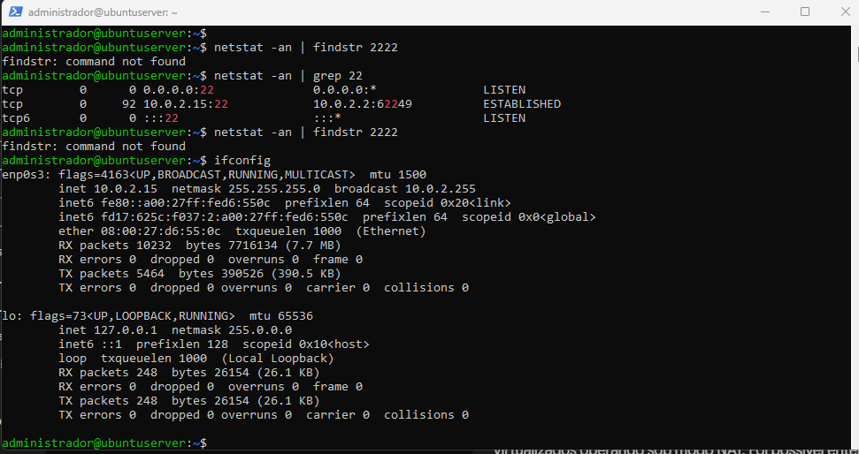

# Relatório Técnico - Aula 05: Acesso Remoto SSH via Redirecionamento de Portas no VirtualBox e Diagnóstico de Rede

## 1. Identificação
- **Nome:** [Seu Nome Completo]
- **Matrícula:** [Sua Matrícula]
- **Turma:** BSI 2026.02
- **Data:** 14/10/2026
- **Título:** Acesso Remoto SSH via Redirecionamento de Portas no VirtualBox e Diagnóstico de Rede

## 2. Objetivo
Configurar o acesso remoto seguro via SSH (Secure Shell) à máquina virtual Ubuntu Server no VirtualBox sob o modo NAT utilizando o mecanismo de Redirecionamento de Portas (Port Forwarding), bem como realizar a inspeção e diagnóstico de interfaces, rotas, sessões ativas e portas TCP no Linux Guest e no Windows Host.

## 3. Ambiente
- **Sistema Hospedeiro (Host):** Windows 11
- **Hipervisor:** Oracle VM VirtualBox
- **Sistema Convidado (Guest):** Ubuntu Server LTS
- **Interface de Rede:** NAT (IP do Convidado: `10.0.2.15/24`, Gateway: `10.0.2.2`)
- **Encaminhamento de Portas:** TCP Host `127.0.0.1:2222` -> Guest `10.0.2.15:22`

## 4. Procedimento
1. Instalação e atualização dos utilitários de rede no Ubuntu Server (`sudo apt update && sudo apt install -y net-tools traceroute`).
2. Inspeção diagnóstica das interfaces (`ifconfig`), tabela de rotas (`route -n`), rastreamento de pacotes (`traceroute 8.8.8.8`) e sessões ativas (`w`).
3. Verificação inicial do estado das portas no Windows Host via PowerShell (`netstat -an | findstr 2222`).
4. Criação da regra de Port Forwarding nas configurações de rede da VM no VirtualBox.
5. Estabelecimento da conexão SSH remota a partir do PowerShell do Windows (`ssh administrador@127.0.0.1 -p 2222`).
6. Validação das conexões ativas nos estados `LISTENING` e `ESTABLISHED` no Host e identificação do pseudo-terminal remoto `pts/0` no Guest.

## 5. Testes e Evidências

### 5.1. Diagnósticos no Linux Guest (Ubuntu)



#### A. Interfaces de Rede (`ifconfig`)
```text
enp0s3: flags=4163<UP,BROADCAST,RUNNING,MULTICAST>  mtu 1500
        inet 10.0.2.15  netmask 255.255.255.0  broadcast 10.0.2.255
        ether 08:00:27:d6:55:0c  txqueuelen 1000  (Ethernet)
